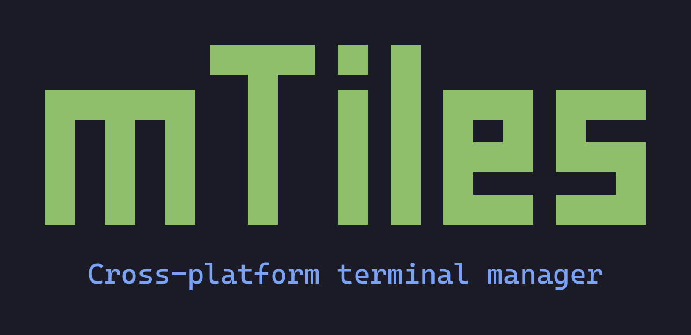
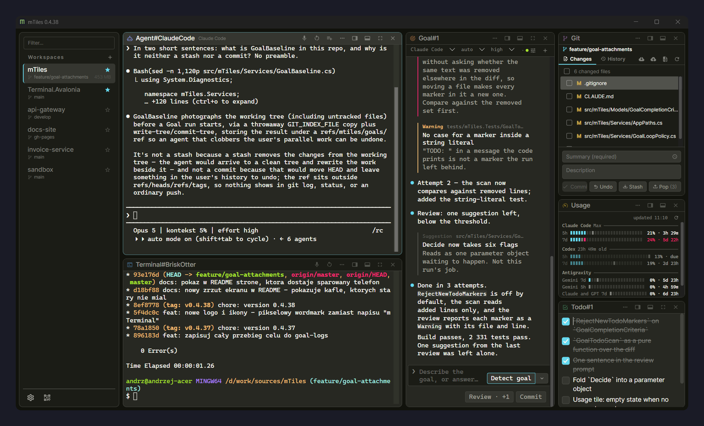
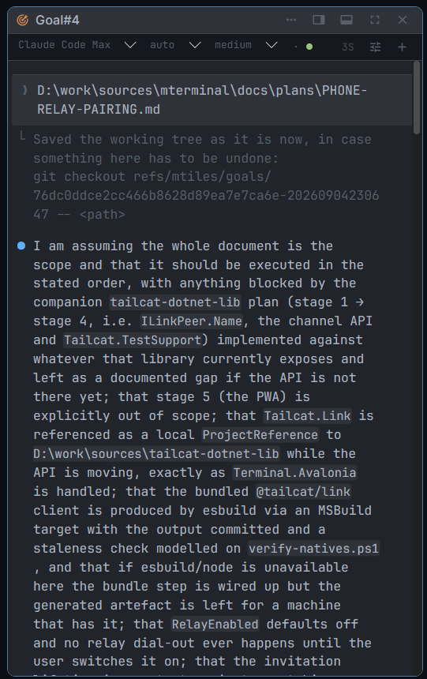
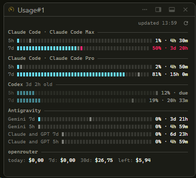
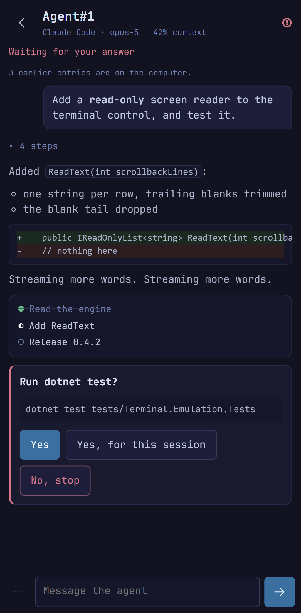

  

  <b>A tiled workspace for running AI coding agents — side by side, for hours, without babysitting.</b> 
  Windows · Linux · .NET 10 · Avalonia 12

  <a href="https://github.com/b-y-t-e/mTiles/releases/latest">Download</a>

## Why

Working with several AI agents means several terminals, several accounts and a constant worry about
what each of them is doing. mTiles puts them in one window: every workspace is a project directory,
every tile is an agent, a terminal or a tool, and all of it comes back exactly as you left it.

## What you get

**Agents**
- Claude Code, Codex, OpenCode, pi, Antigravity and Grok — as a chat (**Agent** tile) or as their own TUI (**Terminal agent** tile).
- Close the app, reopen it: every agent resumes the same conversation. A crashed CLI restarts itself.
- Several accounts per agent — subscriptions, API keys, OpenRouter, a local LM Studio or Ollama.
- Switch agent mid-task: the work is handed over with a brief instead of starting from zero.

**Long, unattended work**
- **Goal** tile: question → plan → implement → review → repeat until the criteria you set are met. The working tree is snapshotted first.
- **Spec** tile: the same loop driven by a versioned specification and plan you edit by talking to it.

**Around the agents**
- **Git**, **Database** (agents query SQL Server/PostgreSQL through a local bridge, writes blocked by default), **Scripts**, **Usage** (each account's limits), **Note**, **Todo**, **Terminal**.
- Plugins: a tile can be an HTML page from your own folder or a shared source.
- Workspaces with tabs and git worktrees; tiles split, drag, swap and go full screen.
- Dictation recognised locally, and a paired phone to follow agents and answer them from anywhere — no port opened.
- One palette: the terminal theme colours the whole interface, 17 themes, dark and light.

## Screens

<table>
  <tr>
    <td width="34%" valign="top"> Goal tile mid-run: model, mode and effort, and what it has done so far.</td>
    <td width="33%" valign="top"> Usage: every account's limit windows, and what is left on a key.</td>
    <td width="33%" valign="top"> Phone: an agent's conversation with its pending approval.</td>
  </tr>
</table>

## Install

From [Releases](https://github.com/b-y-t-e/mTiles/releases/latest):

| Platform | File |
|---|---|
| Windows | `mTiles-win-Setup.exe` (updates itself) or `mTiles-win-Portable.zip` |
| Linux | `mTiles-linux-x86_64.AppImage` or `mTiles-linux-x64.tar.gz` |
| Arch Linux | signed pacman repository — see [`packaging/arch/README.md`](packaging/arch/README.md) |

On Arch-based systems the AppImage needs FUSE 2 (`sudo pacman -S fuse2`), or run it with
`--appimage-extract-and-run`. Dictation from the local microphone needs ALSA (`alsa-lib`/`pipewire-alsa`).

The agents themselves are not bundled — install the CLIs you use, or press **Install…** next to one in
Settings → AI.

## Good to know

- Run mTiles unelevated on Windows — an elevated process cannot receive files dragged from Explorer.
- Inside a full-screen TUI that grabs the mouse (vim, mc, opencode), hold **Shift** to select text.
- On Linux an agent needs `wl-clipboard` or `xclip` to see a pasted image.
- A paired phone talks through Tailscale's public relays, end-to-end encrypted by [tailcat-link](https://github.com/b-y-t-e/tailcat-link).

## Built with

.NET 10, Avalonia 12, CommunityToolkit.Mvvm, AvaloniaEdit and **Terminal.Avalonia** — our own terminal
control (VT engine, ConPTY/forkpty, rendering), published on NuGet. MIT licence.

This repository holds the README and the releases; the sources are developed privately.
